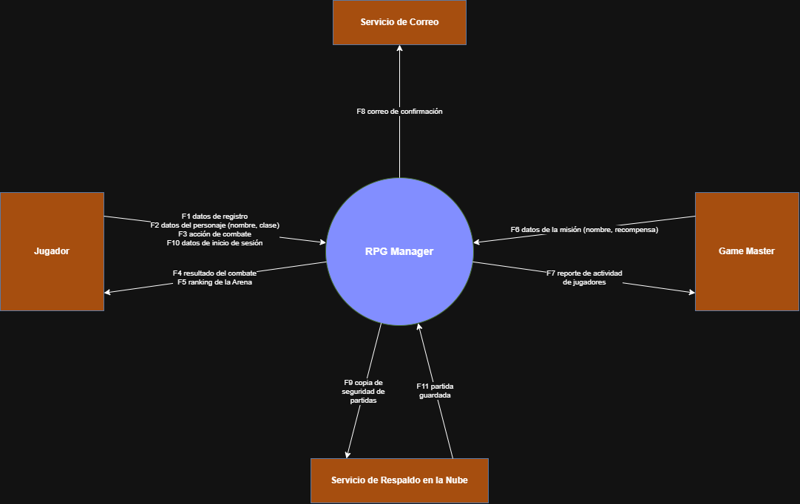
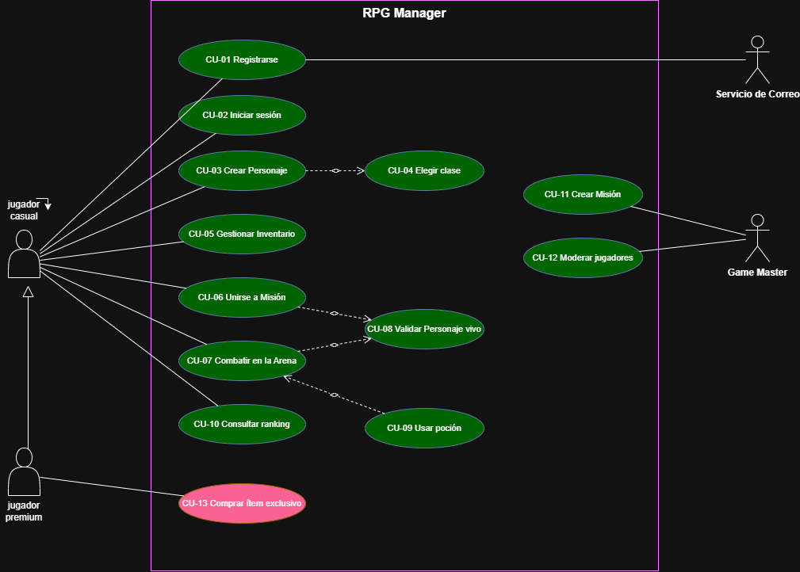

# Taller de Diagramas Draw.io - RPG Manager

Repositorio para la entrega del taller de diagramas del proyecto **RPG Manager**, desarrollado en **Draw.io**.

---

## Autor

**Jerferson David Rodriguez Guarnizo**  
* **Institución:** Universidad Distrital Francisco José de Caldas  
* **Código Estudiantil:** `20231578036`

---

## Diagramas del Proyecto

### 1. Diagrama de Casos de Uso

---

### 2. Modelo Entidad-Relación (DER)

---

### 3. Diagrama de Clases / Arquitectura

---

